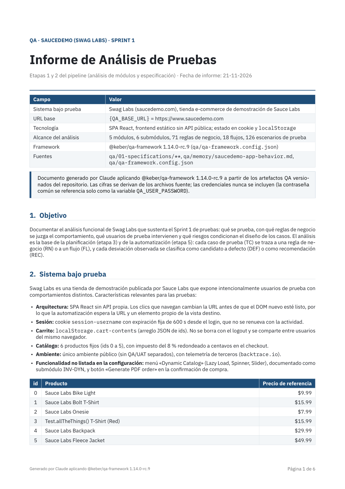
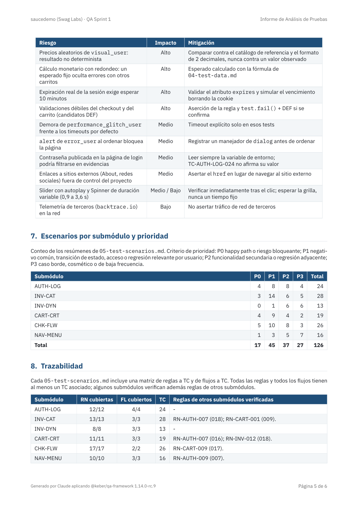
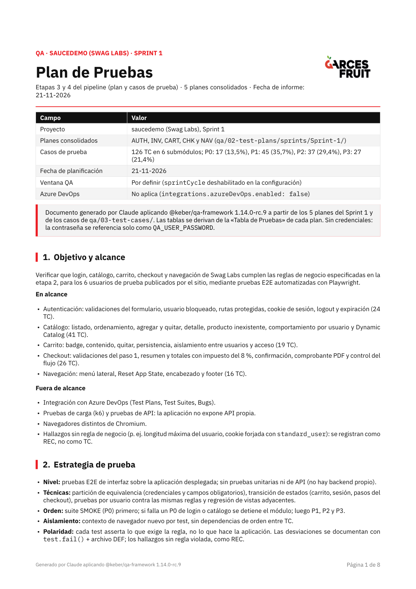
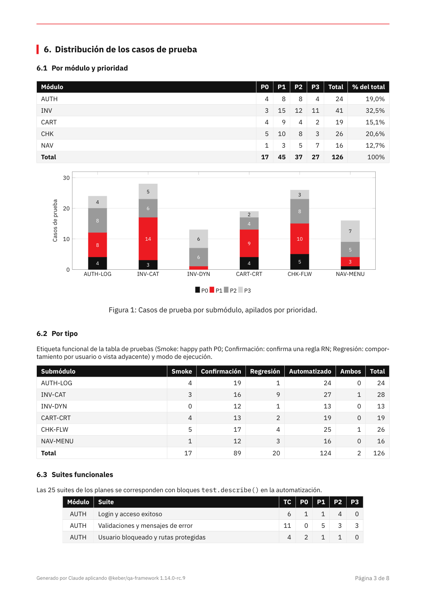
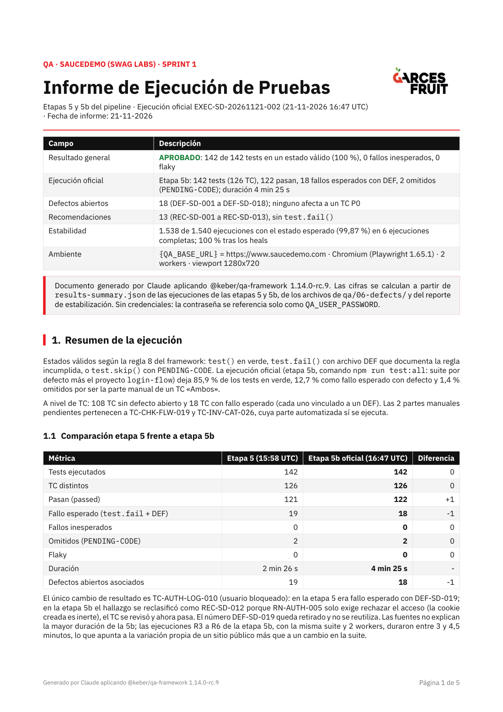
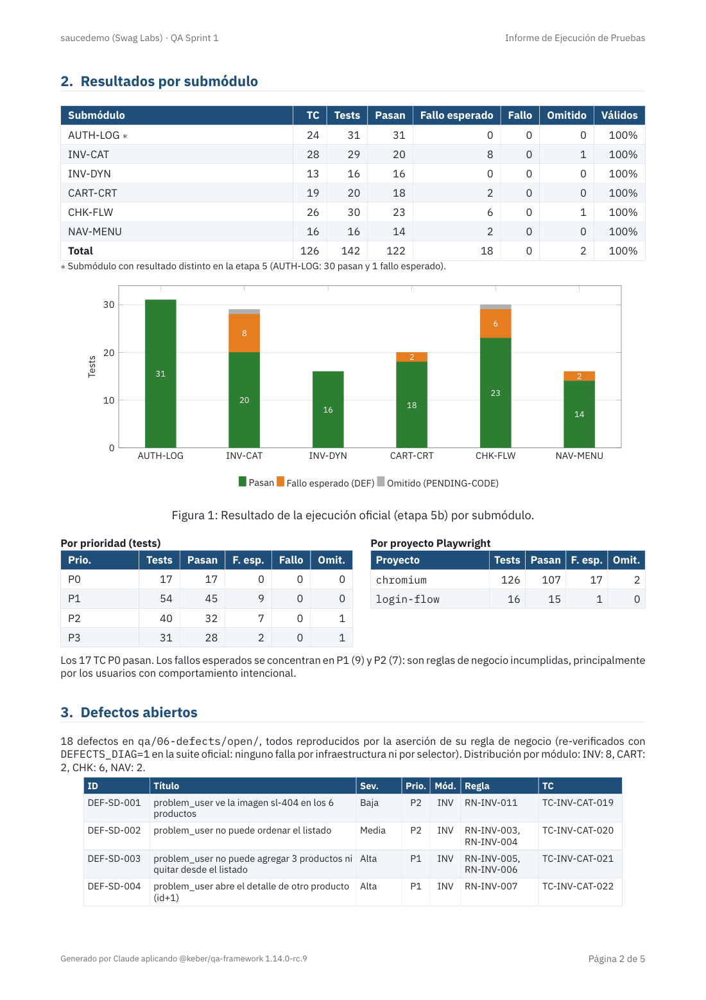

# demo-qaframework-saucedemo

Repositorio de **demostración** de las capacidades de [`@keber/qa-framework`](https://www.npmjs.com/package/@keber/qa-framework) (versión `1.14.0-rc.9`, tag `next`) aplicado con **Claude** (Claude Code) sobre la tienda demo [saucedemo.com](https://www.saucedemo.com/) (Swag Labs, de Sauce Labs).

Todo el contenido de este repositorio (configuración del framework, especificaciones, plan de pruebas, casos de prueba, automatización Playwright, defectos, recomendaciones, ejecuciones, estabilización e informes finales en LaTeX/PDF) fue generado por Claude a partir de **un único prompt inicial**, reproducido más abajo.

> saucedemo.com es un sistema de demostración que publica intencionalmente sus usuarios de prueba y su contraseña común. El código lee las credenciales desde variables de entorno (`qa/07-automation/e2e/.env`, excluido de git); en la documentación se referencian como `QA_USER_PASSWORD` / `<PLACEHOLDER>`.

## El prompt inicial

Bastó este prompt para generar el contenido completo del repositorio, incluidos los informes finales:

```text
Crea un nuevo directorio llamado saucedemo, inicializa git, instala y configura el paquete npm @keber/qa-framework@next en dicha carpeta, configurando como proyecto a testear https://www.saucedemo.com/ , existen varios usuarios para múltiples escenarios, y la contraseña o password para todos ellos es "secret_sauce". Los usuarios son:

* standard_user
* locked_out_user
* problem_user
* performance_glitch_user
* error_user
* visual_user


Nota: La web objetivo del proyecto es un sistema de demostración, e intencionalmente publica un a lista de usuarios y contraseña para exploración y ejecución de pruebas, por lo que en este caso particular colocar la password en la sesión de claude no constituye una brecha de seguridad.

Una vez configurado el framework, coordina sub-agentes modelo Opus 5.5 Medio para que ejecuten las etapas del pipeline del framework hasta las pruebas end to end con playwright y la etapa de healing, sin incluir integración con Azure DevOps. Utiliza gitflow y merge --no-ff para ir actualizando el repo. Una vez finalizada la aplicación del framework, genera los informes de análisis de pruebas, plan de pruebas y ejecución de pruebas en latex y PDF y añádelos al repo.

Sube el repo a mi github en modo público con el nombre demo-qaframework-saucedemo . Actualiza el readme para que explique que el propósito del repo es una demostración las capacidades del qa-framework aplicado con Claude a la tienda demo "saucedemo.com"  . Incluye el prompt inicial, indicando que bastó ese prompt para generar el contenido del repo incluyendo los reportes finales.

Incluye en el readme snapshots de los informes PDF.
```

## Cómo se construyó

Claude actuó como **orquestador**: instaló y configuró el framework y luego delegó cada etapa del pipeline a un sub-agente (Opus 5.5, esfuerzo medio), integrando cada resultado con gitflow (`feature/*` -> `develop` con `merge --no-ff`, y `release` -> `main`).

| Etapa | Skill del framework | Rama | Resultado |
|---|---|---|---|
| Setup | `npm install @keber/qa-framework@next` | `main` | `qa/` scaffold, config del proyecto, 6 usuarios de prueba |
| 1 | `qa-module-analysis` | `feature/stage-1-module-analysis` | Exploración en vivo con Playwright; spec set de 6 archivos por submódulo |
| 2 | `qa-spec-generation` | `feature/stage-2-spec-generation` | Trazabilidad RN/FL -> TC, brechas cerradas, 126 TC |
| 3 | `qa-test-plan` | `feature/stage-3-test-plan` | 5 Planes de Pruebas (uno por módulo) |
| 4 | `qa-test-cases` | `feature/stage-4-test-cases` | Pasos expandidos con selectores `data-test` y resultados medibles |
| 5 | `qa-automation` | `feature/stage-5-automation` | 142 tests Playwright (POM), defectos y recomendaciones |
| 5b | `qa-test-stabilization` (healing) | `feature/stage-5b-healing` | 6 corridas / 1.540 ejecuciones, 3 heals, cierre del sprint |
| Informes | LaTeX + Tectonic | `feature/reports` | 3 informes PDF + snapshots |

Fuera de alcance (por indicación del prompt): integración con Azure DevOps.

## Resultados

- **Alcance:** 5 módulos (AUTH, INV, CART, CHK, NAV), 6 submódulos, 71 reglas de negocio, 126 casos de prueba (P0 17, P1 45, P2 37, P3 27).
- **Ejecución oficial (etapa 5b):** 142 tests -> **122 pasan**, **18 fallos esperados** (`test.fail()` con defecto documentado), **2 omitidos** (`PENDING-CODE`, parte manual de 2 TC), **0 fallos inesperados**.
- **Defectos:** 18 abiertos (`DEF-SD-001` a `DEF-SD-018`), la mayoría ligados a los usuarios con comportamiento defectuoso intencional (`problem_user`, `error_user`, `visual_user`) y algunos que afectan a todos los usuarios (p. ej. checkout con carrito vacío).
- **Recomendaciones:** 13 (`REC-SD-001` a `REC-SD-013`), hallazgos que no violan reglas de negocio.
- **Estabilidad:** 1.538 de 1.540 ejecuciones con el resultado esperado (99,87 %); las 2 intermitencias se clasificaron como defectos de automatización y se corrigieron sin debilitar aserciones.

Regla clave del framework aplicada: **los tests afirman lo que exige la especificación, no lo que hace la aplicación**. Cuando la app incumple la spec, el test queda en `test.fail()` y existe un archivo de defecto que lo justifica.

## Informes finales (PDF)

| Informe | PDF | Fuente |
|---|---|---|
| Informe de Análisis de Pruebas | [informe-analisis-pruebas.pdf](reports/01-informe-analisis-pruebas/informe-analisis-pruebas.pdf) | [.tex](reports/01-informe-analisis-pruebas/informe-analisis-pruebas.tex) |
| Plan de Pruebas | [plan-de-pruebas.pdf](reports/02-plan-de-pruebas/plan-de-pruebas.pdf) | [.tex](reports/02-plan-de-pruebas/plan-de-pruebas.tex) |
| Informe de Ejecución de Pruebas | [informe-ejecucion-pruebas.pdf](reports/03-informe-ejecucion-pruebas/informe-ejecucion-pruebas.pdf) | [.tex](reports/03-informe-ejecucion-pruebas/informe-ejecucion-pruebas.tex) |

### Snapshots

**Informe de Análisis de Pruebas**

<p>
  
  
</p>

**Plan de Pruebas**

<p>
  
  
</p>

**Informe de Ejecución de Pruebas**

<p>
  
  
</p>

## Auditoría de la suite (qa-suite-audit)

**Reporte HTML publicado:** https://keber.github.io/demo-qaframework-saucedemo/

### Origen y propósito

Después de generar la suite, se auditó con [`@keber/qa-suite-audit`](https://www.npmjs.com/package/@keber/qa-suite-audit) 0.1.0, una herramienta de auditoría repetible y basada en evidencia para suites de pruebas automatizadas. Implementa la rúbrica de 7 criterios publicada por Adriana Troche Robles en [Calidad sin Humo](https://calidadsinhumo.com/guias/rubrica-para-juzgar-una-suite-de-tests/): Oráculo, Sensibilidad, Determinismo, Diagnóstico, Cobertura de reglas de negocio, Vida en CI y Mantenibilidad, en una escala de 0 a 3.

El propósito es responder con evidencia si la suite generada **sirve**, más allá de que esté en verde. La herramienta separa tres roles:

1. **Scripts** que extraen evidencia del repositorio (`audit/input.json`).
2. **Un agente** (aquí, un sub-agente de Claude) que asigna cada nivel citando esa evidencia y dentro de los límites que ella permite (`audit/verdict.json`).
3. **Un validador** que rechaza un veredicto sin citas, fuera de límites o escrito contra otra evidencia.

La versión 0.1.0 lee solo el repositorio (sin API de CI ni historial de ejecuciones), por lo que de los 21 puntos de la rúbrica original son alcanzables como máximo 16.

```bash
npx qa-suite-audit evidence . --out audit/input.json
npx qa-suite-audit validate audit/input.json audit/verdict.json
npx qa-suite-audit report audit/input.json audit/verdict.json --format html --out audit/report.html
```

### Resultados generales

**Tipo de suite:** regresión. **Resultado: 12 / 16 alcanzables** (veredicto `VALID`). Con la evidencia disponible, el máximo posible era 14, porque el repositorio no tiene pipeline de CI.

| Dimensión | Nivel | Motivo principal |
|---|---|---|
| D1 Oráculo | 2 / 3 | Las aserciones verifican valores de las reglas (p. ej. el impuesto del 8 %), pero las reglas se derivaron en gran parte del comportamiento observado de la propia app |
| D2 Sensibilidad | 2 / 3 | No hay mutation testing configurado (límite en 2); los defectos fijados fallan la corrida si dejan de reproducirse |
| D3 Determinismo | 2 / 2 | Sin esperas fijas y con esperas por condición; el máximo alcanzable sin medición de flakiness en CI |
| D4 Diagnóstico | 2 / 3 | Trace, video y screenshot en fallos; los títulos llevan ID de caso, no de regla |
| D5 Cobertura de reglas | 2 / 2 | Las 72 reglas de negocio detectadas tienen test; no hay tests huérfanos |
| D6 Vida en CI | 0 / 1 | No hay pipeline en el repositorio |
| D7 Mantenibilidad | 2 / 2 | 82 % de selectores semánticos (`data-test`), 85 % de tests a través de page objects o helpers |

Ninguna dimensión eliminatoria (D1, D2) quedó en 0. Las preguntas que solo el equipo puede responder (mutation testing, medición de flakiness entre corridas, exclusiones deliberadas, pipeline externo, retiro de tests) quedan listadas en el reporte sin responder, como exige el protocolo.

**Límites de la herramienta observados en esta auditoría** (se reportan; la evidencia no se editó):

- No detecta los 18 `test.fail()` invocados desde el helper `expectOpenDefect()`.
- Marca como "sin aserción" un test que usa `expect.poll()`.
- No lee la tabla de trazabilidad de flujos (`FL-*`) de los `05-test-scenarios.md`, por lo que la cobertura real probablemente es mayor que la reportada.

Archivos: [`audit/verdict.json`](audit/verdict.json), [`audit/report.txt`](audit/report.txt), [`audit/report.html`](audit/report.html).

## Estructura del repositorio

```
.
├── qa/
│   ├── 01-specifications/     # Spec sets (inventario, reglas, flujos, roles, datos, escenarios)
│   ├── 02-test-plans/         # Planes de Pruebas del Sprint 1
│   ├── 03-test-cases/         # TC documentados para la parte manual
│   ├── 05-test-execution/     # Resultados de ejecución (JSON + reporte)
│   ├── 06-defects/            # DEF abiertos y REC
│   ├── 07-automation/e2e/     # Proyecto Playwright (POM, fixtures, specs)
│   ├── memory/                # Aprendizajes del proyecto
│   └── qa-framework.config.json
├── reports/                   # Informes LaTeX + PDF + snapshots
├── audit/                     # Evidencia, veredicto y reportes de qa-suite-audit
├── docs/                      # Reporte HTML de la auditoría (GitHub Pages)
├── .claude/ y .github/        # Reglas, comandos y skills instalados por el framework
└── package.json
```

## Ejecutar las pruebas

Requisitos: Node.js 20+.

```bash
npm install
cd qa/07-automation/e2e
npm install
npx playwright install chromium
npm run test:all
```

Antes de ejecutar, crear `qa/07-automation/e2e/.env` (excluido de git) con las variables que usa la suite:

```dotenv
QA_BASE_URL=https://www.saucedemo.com
QA_USER_EMAIL=standard_user
QA_USER_PASSWORD=<PLACEHOLDER>   # contraseña publicada en la página de login de saucedemo
QA_USER_STANDARD_USER_USERNAME=standard_user
QA_USER_LOCKED_OUT_USER_USERNAME=locked_out_user
QA_USER_PROBLEM_USER_USERNAME=problem_user
QA_USER_PERFORMANCE_GLITCH_USER_USERNAME=performance_glitch_user
QA_USER_ERROR_USER_USERNAME=error_user
QA_USER_VISUAL_USER_USERNAME=visual_user
```

El índice vivo del proceso QA está en [`qa/README.md`](qa/README.md).

---

Generado por Claude aplicando `@keber/qa-framework` 1.14.0-rc.9. Proyecto de demostración sin afiliación con Sauce Labs.
