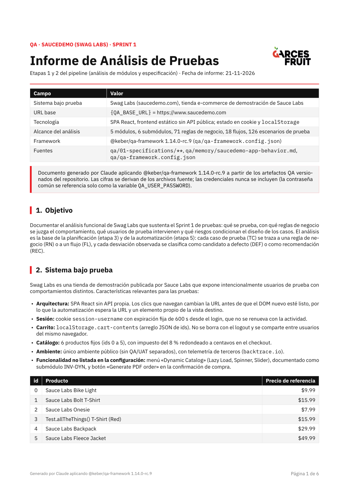
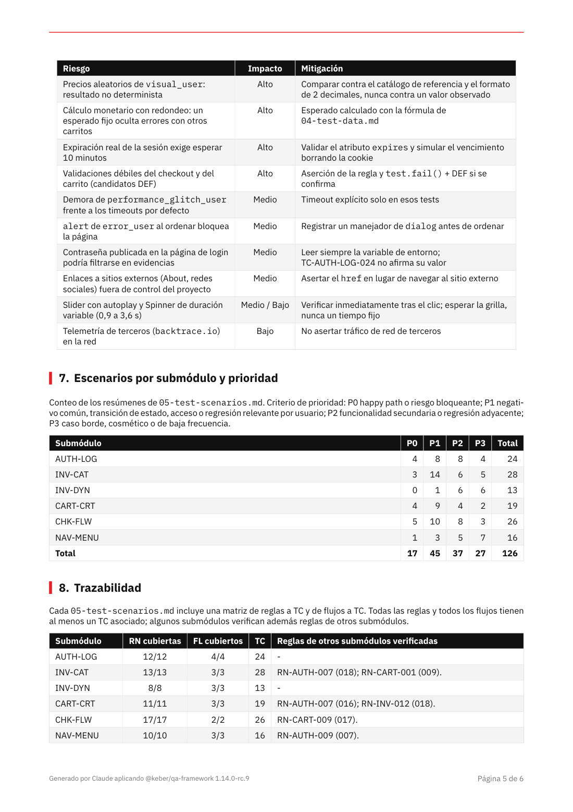
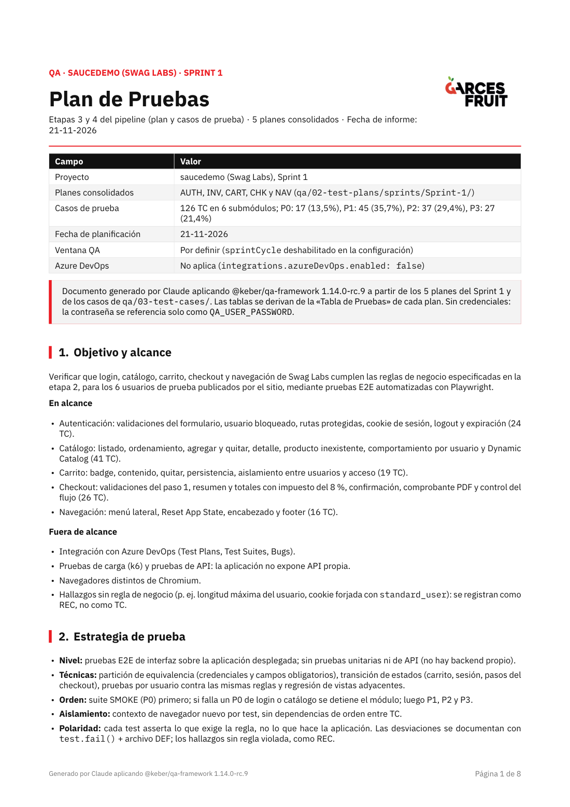
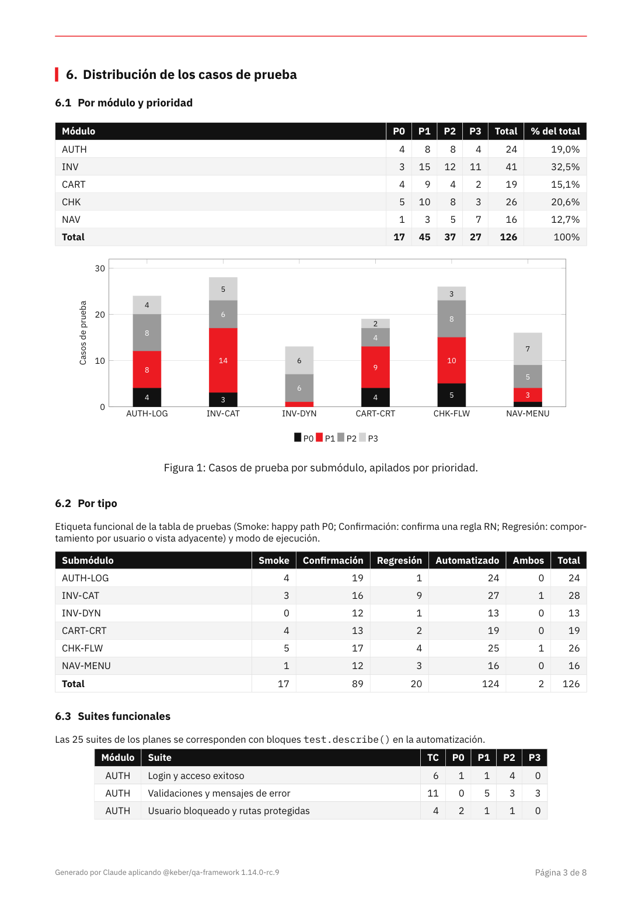
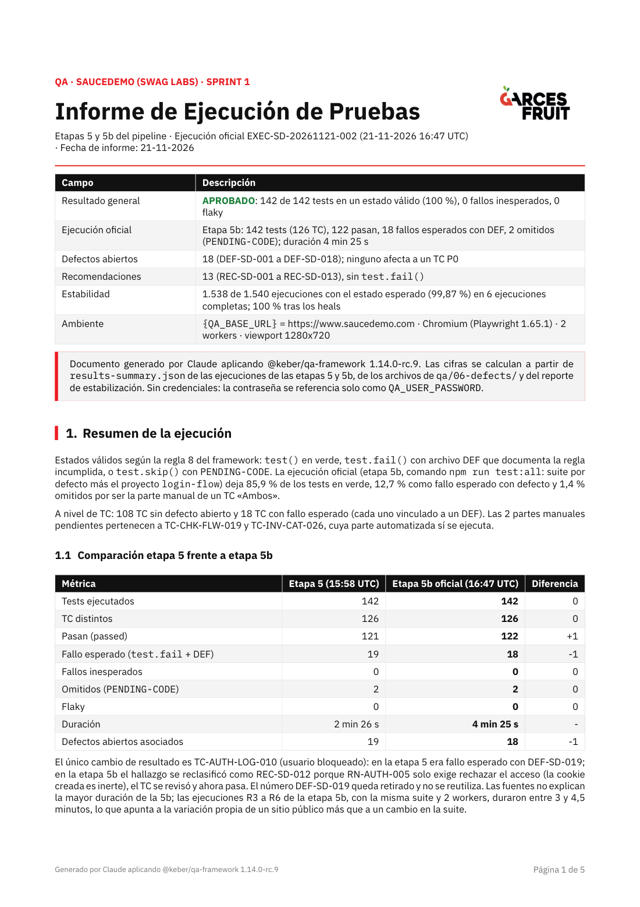
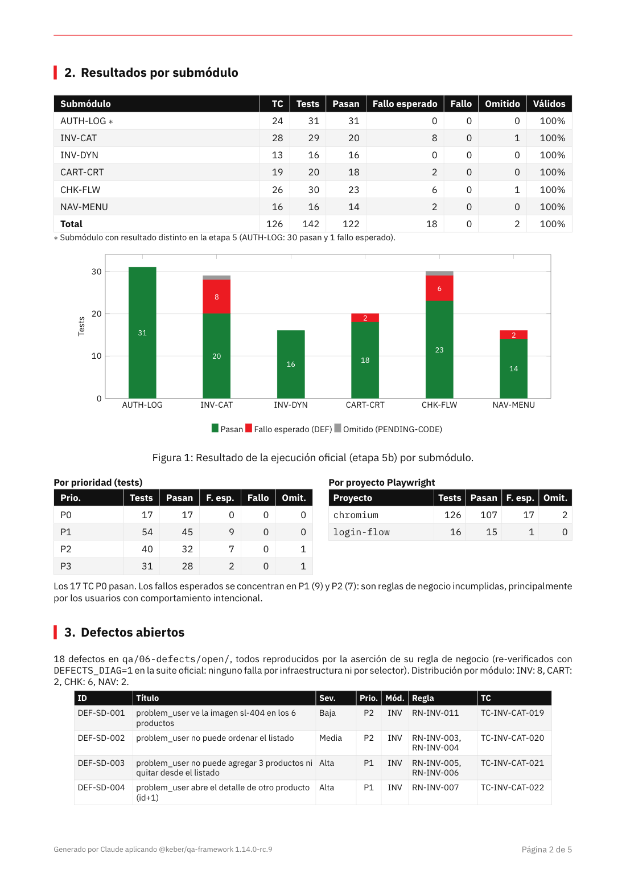

# Informes QA - saucedemo Sprint 1

Informes finales del Sprint 1 de pruebas de Swag Labs (saucedemo.com), en LaTeX y PDF. Se generaron a partir de los artefactos versionados en `qa/` y se compilaron con Tectonic.

> Documentos generados por Claude aplicando `@keber/qa-framework` 1.14.0-rc.9. No contienen credenciales: la contraseña común se referencia solo como la variable `QA_USER_PASSWORD`.

| N.º | Informe | PDF | Fuente LaTeX | Páginas | Fuentes principales |
|---|---|---|---|---|---|
| 1 | Informe de Análisis de Pruebas | [PDF](01-informe-analisis-pruebas/informe-analisis-pruebas.pdf) | [.tex](01-informe-analisis-pruebas/informe-analisis-pruebas.tex) | 6 | `qa/01-specifications/**`, `qa/memory/saucedemo-app-behavior.md`, `qa/qa-framework.config.json` |
| 2 | Plan de Pruebas | [PDF](02-plan-de-pruebas/plan-de-pruebas.pdf) | [.tex](02-plan-de-pruebas/plan-de-pruebas.tex) | 8 | `qa/02-test-plans/sprints/Sprint-1/*.md`, `qa/03-test-cases/*.md` |
| 3 | Informe de Ejecución de Pruebas | [PDF](03-informe-ejecucion-pruebas/informe-ejecucion-pruebas.pdf) | [.tex](03-informe-ejecucion-pruebas/informe-ejecucion-pruebas.tex) | 5 | `qa/05-test-execution/automated/*/results-summary.json`, `qa/06-defects/**`, `qa/07-automation/STABILIZATION-REPORT-2026-11-21.md` |

## Contenido

1. **Análisis de pruebas:** objetivo, sistema bajo prueba, 5 módulos y 6 submódulos, las 71 reglas de negocio, los 6 usuarios de prueba y su comportamiento, riesgos, 126 escenarios por submódulo y prioridad, trazabilidad (todas las reglas y flujos cubiertos) y observaciones clave.
2. **Plan de pruebas:** alcance, estrategia, ambiente, criterios de entrada y salida, matriz de usuarios, distribución de los 126 TC por módulo, prioridad y tipo (con gráfico), suites, cronograma de etapas del pipeline, riesgos y anexo con la lista completa de TC.
3. **Ejecución de pruebas:** ejecución oficial de la etapa 5b (142 tests: 122 pasan, 18 fallos esperados con defecto, 2 omitidos por `PENDING-CODE`) comparada con la etapa 5, resultados por submódulo (con gráfico), defectos DEF-SD-001 a 018, recomendaciones REC-SD-001 a 013, análisis de estabilidad (6 ejecuciones, 1.540 ejecuciones de test), evaluación de los criterios de salida y conclusiones.

## Vista previa

| Informe | Portada | Página interior |
|---|---|---|
| Análisis |  |  |
| Plan |  |  |
| Ejecución |  |  |

## Recompilar

Desde la carpeta de cada informe (el logo `garcesfruit-logo.png` debe estar junto al `.tex`):

```bash
tectonic informe-analisis-pruebas.tex
```

Tectonic usa XeTeX y las fuentes IBM Plex de su propio bundle, por lo que el resultado es el mismo en cualquier máquina. Los archivos intermedios (`.aux`, `.log`, `.out`, `.toc`) no se versionan.
